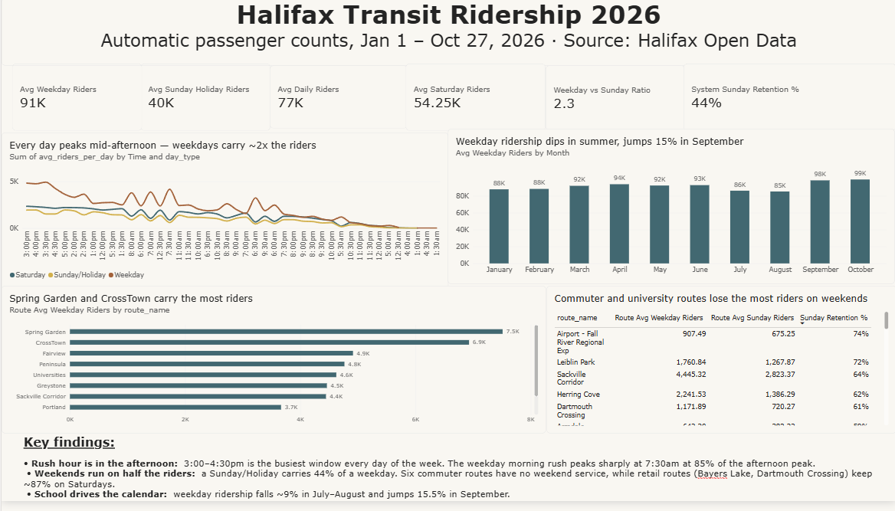

# Halifax Transit Ridership Analysis (2026)

An end-to-end analysis of **863,000+ automatic passenger counts** from Halifax Transit, covering
January 1 – October 27, 2026. The project cleans and validates the raw data in **Python**, answers
service-planning questions in **PostgreSQL**, and presents the results in a **Power BI** dashboard.

**Tools:** Python (pandas, NumPy) · PostgreSQL · Power BI (DAX) · Jupyter



---

## Business questions

1. When is rush hour, and does it change between weekdays and weekends?
2. How concentrated is ridership across routes?
3. Which routes lose their riders on weekends, and which keep them?
4. How does ridership change through the year?

## Key findings

| Metric | Value |
|---|---|
| Average riders per weekday | **91,434** |
| Average riders per Saturday | **54,252** |
| Average riders per Sunday / holiday | **39,805** |
| Weekday vs Sunday ridership | **2.3x** |
| Routes carrying half of all riders | **9 of 76** |

- **Rush hour is in the afternoon, every day.** Weekdays and Saturdays peak between 3:00 and
  4:30pm, and Sundays/holidays a little later, around 4:00–5:30pm. The weekday morning rush is sharp but smaller: it peaks at 7:30am at
  85% of the afternoon peak and falls to 53% by 8:30am.
- **Ridership is highly concentrated.** Just 9 of 76 routes carry half of all riders. Spring Garden
  alone carries 8.6%.
- **Weekends run on less than half the riders.** A Sunday or holiday carries 44% of a weekday's
  riders. Six of the larger commuter routes have no weekend service at all. University and express routes keep only
  ~30–40% of their riders on Sundays, while retail routes such as Bayers Lake and Dartmouth Crossing
  keep ~87% on Saturdays, and the Airport route keeps 74% on Sundays.
- **The school calendar drives the year.** Weekday ridership falls ~9% in July–August and jumps
  15.5% in September when classes resume. September–October is the busiest period in the data.

### Recommendations

1. **Plan two different rush hours.** Concentrate extra morning capacity in a narrow 7:00–8:30am
   window, and sustain afternoon capacity over the longer 3:00–4:30pm window.
2. **Shape weekend service around shopping and airport trips, not commuting.** Retail and airport
   routes hold their riders on weekends; university and express routes do not.
3. **Use the school year to schedule capacity.** Summer schedules can run lighter, with service
   restored before September's jump.

---

## Approach

```
Raw APC data (CSV)
   │  Python / pandas  →  clean, validate, classify day types
   ▼
apc_clean.csv
   │  PostgreSQL       →  analysis queries + views for reporting
   ▼
SQL views
   │  Power BI         →  DAX measures + one-page dashboard
   ▼
Dashboard
```

### 1. Cleaning and validation (Python)
[`notebooks/01_data_cleaning.ipynb`](notebooks/01_data_cleaning.ipynb)

- **Outliers:** the largest value (3,930 riders in one half-hour on a route that normally averages
  31) is a sensor error. 64 rows above 300 riders (0.007% of the data) were removed.
- **Coverage check:** confirmed 299 of 300 days are present (Sept 19 is missing) and that every
  weekday appears 42–43 times, so weekday comparisons are fair.
- **Holiday detection:** nine Monday–Friday dates had exactly the same number of records as a
  Sunday. Each was a Nova Scotia holiday, which showed that Halifax Transit runs its Sunday schedule
  on holidays. Every day was classified as **Weekday**, **Saturday** or **Sunday/Holiday**.
- **Fair comparisons:** ridership is totalled per day before averaging, so day types and months with
  different numbers of days are compared on equal terms.

### 2. Analysis (SQL)
[`sql/`](sql/)

| File | Contents |
|---|---|
| [`01_create_table.sql`](sql/01_create_table.sql) | Table definition and load instructions |
| [`02_data_checks.sql`](sql/02_data_checks.sql) | Row counts and date coverage, checked against the notebook |
| [`03_analysis.sql`](sql/03_analysis.sql) | Eight business questions, each with its result in a comment |
| [`04_views.sql`](sql/04_views.sql) | Reporting views used by Power BI |

Techniques used: CTEs, window functions (`RANK`, `LAG`, running totals with `ROWS BETWEEN`,
`PARTITION BY`), conditional aggregation with `FILTER` to pivot data, `DATE_TRUNC`, and views.

### 3. Dashboard (Power BI)
[`Halifax_Transit_Ridership_2026.pbix`](Halifax_Transit_Ridership_2026.pbix)

- Imports three SQL views, each with a clear grain (per day, per route per day, per day type per
  half-hour).
- DAX measures built with `CALCULATE` and `DIVIDE`. Every KPI was checked against the SQL results.
- Chart titles state the finding, not just the topic.

---

## Repository structure

```
halifax-transit-analysis/
├── README.md
├── requirements.txt
├── .gitignore
├── Halifax_Transit_Ridership_2026.pbix   # Power BI dashboard
├── data/                          # not committed (see "Data" below)
│   ├── apc_ridership.csv          # raw download
│   └── apc_clean.csv              # output of the notebook
├── notebooks/
│   └── 01_data_cleaning.ipynb
├── sql/
│   ├── 01_create_table.sql
│   ├── 02_data_checks.sql
│   ├── 03_analysis.sql
│   └── 04_views.sql
└── images/
    └── dashboard.png
```

## Data

**Source:** *Transit Automated Passenger Counts*, Halifax Regional Municipality Open Data
([data-hrm.hub.arcgis.com](https://data-hrm.hub.arcgis.com)), used under the Halifax Open Data licence.

The CSV files (~60–70 MB each) are not stored in this repository. To reproduce the project,
download the dataset as CSV and save it as `data/apc_ridership.csv`.

## How to reproduce

1. **Python:** install the requirements and run the notebook from top to bottom.
   ```bash
   pip install -r requirements.txt
   jupyter notebook notebooks/01_data_cleaning.ipynb
   ```
2. **PostgreSQL:** create a database, run `sql/01_create_table.sql`, import `data/apc_clean.csv`,
   then run `02` → `04`.
3. **Power BI:** open the `.pbix` file and update the PostgreSQL connection
   (Transform data → Data source settings) to point at your database, then Refresh.

## Limitations

- **Only 10 months of data.** Fall is busier than winter, but without a full prior year it is not
  possible to separate real growth from seasonal patterns.
- **One missing day** (Saturday, September 19, 2026).
- **Outlier threshold is a judgement call.** 300 riders per route-direction per half-hour was chosen
  as a conservative ceiling; it removes 0.007% of rows.
- **Holidays are inferred** from the reduced schedule size rather than taken from an official
  calendar.
- **Route-level weekend comparisons** only count days when a route runs, so weekday-only routes
  appear with no weekend value.

---

## Author

**Jenoah Gonsalves**
[LinkedIn](https://www.linkedin.com/in/jenoah-gonsalves-106113146/) · [GitHub](https://github.com/Jenzzzz7)
